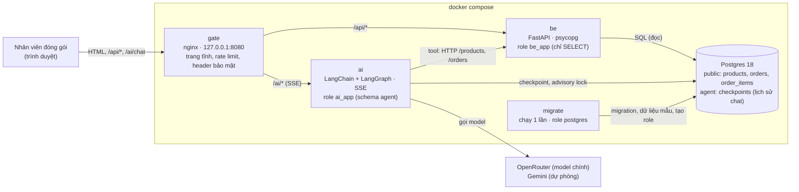
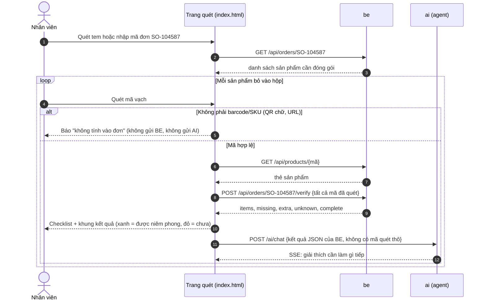
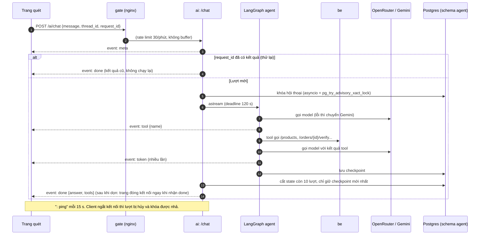
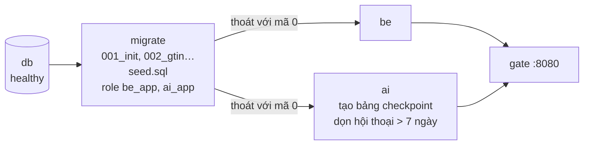
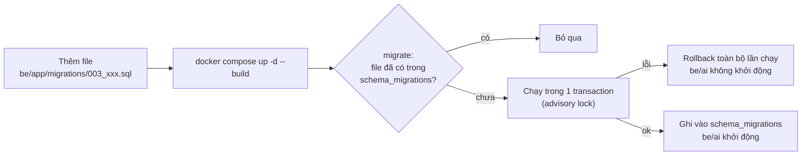

# Barcode Chatbot: kiểm tra đóng gói bằng mã vạch và trợ lý AI

Nhân viên ở bàn đóng gói tải đơn hàng, quét mã vạch từng sản phẩm bỏ vào hộp. Hệ thống tra sản phẩm trong kho, đối
chiếu với đơn và báo **có được niêm phong hộp hay chưa**. Trợ lý AI giải thích kết quả (thiếu gì, cần lấy gì ra) và trả
lời câu hỏi về sản phẩm và đơn hàng.

> **Nguyên tắc an toàn:** quyết định niêm phong do **BE** đưa ra (`POST /orders/{id}/verify` → `complete`).
> AI chỉ giải thích, không bao giờ tự kết luận. Nhờ vậy, một tem QR bị sửa hay một câu trả lời sai của model không thể
> biến một hộp sai thành "được niêm phong".

## Mục lục

- [Tính năng](#tính-năng)
- [Kiến trúc](#kiến-trúc)
- [Luồng xử lý](#luồng-xử-lý)
- [Cấu trúc thư mục](#cấu-trúc-thư-mục)
- [Cài đặt và chạy](#cài-đặt-và-chạy)
- [Cấu hình](#cấu-hình)
- [API](#api)
- [Bảo mật](#bảo-mật)
- [Kiểm thử](#kiểm-thử)
- [Thay đổi database (migration)](#thay-đổi-database-migration)
- [Vận hành](#vận-hành)
- [Giới hạn hiện tại](#giới-hạn-hiện-tại)

## Tính năng

- **Quét mã:** camera (BarcodeDetector hoặc polyfill ZXing WASM), tải ảnh, hoặc nhập tay. Có kiểm tra số kiểm tra
  GS1 và yêu cầu nhiều khung hình đọc trùng nhau trước khi nhận mã.
  Sản phẩm để yên trước camera chỉ được đếm một lần: phải rời khung ít nhất 0,7 s thì cùng mã mới được
  đếm tiếp (hai sản phẩm giống nhau vẫn quét được liên tiếp). Nhiều mã cùng trong khung: mỗi món chỉ đếm một lần,
  món mới được đọc dù món cũ còn trong khung. Camera bị ngắt thì báo lỗi; lệnh giải mã treo quá 3 s thì bỏ qua và quét tiếp.
  Nhập tay cũng kiểm tra số kiểm tra GS1.
- **Tra sản phẩm:** tên, SKU, danh mục, giá, tồn kho. Mã EAN-13 có số 0 đầu, UPC-A 12 số và GTIN-14 được coi là cùng một mã.
- **Kiểm tra đơn:** quét tem mã đơn (hoặc nhập tay) để mở checklist từng sản phẩm (đã quét/cần), cập nhật ngay mỗi lần quét;
  khung kết quả xanh hoặc đỏ: còn thiếu, cần lấy ra, mã không có trong kho. Tem đơn chỉ được đọc khi chưa mở đơn hoặc đơn
  đang mở đã đủ hàng, nên giữa chừng mọi mã quét đều được đếm. Checklist cũng hiện trong khung chat và cập nhật theo mỗi lần quét. Nút "In checklist" in riêng danh sách, có ô ☐ để đánh dấu tay.
- **Trợ lý AI (tiếng Việt):** câu trả lời stream theo thời gian thực (SSE). AI dùng 4 tool gọi API của BE:
  `get_product`, `search_products`, `get_order`, `verify_order`. Lịch sử hội thoại lưu trong Postgres.
- **Ổn định:** hủy lượt khi client ngắt kết nối, giới hạn thời gian mỗi lượt, mỗi hội thoại chạy từng lượt một
  (khóa cả trong process và trong Postgres), thử lại không chạy lặp, model dự phòng khi model chính lỗi.

## Kiến trúc



| Service | Công nghệ | Vai trò |
|---|---|---|
| `gate` | nginx 1.28 | Phục vụ trang quét mã; chuyển `/api/` tới `be` và `/ai/` tới `ai`; rate limit, CSP, chặn Host lạ |
| `be` | Python 3.13, FastAPI, psycopg 3 | Sản phẩm, đơn hàng, đối chiếu đơn. Quyết định niêm phong |
| `ai` | LangChain `create_agent`, LangGraph, AsyncPostgresSaver | Chat SSE, tool gọi BE, lưu lịch sử |
| `migrate` | (image của `be`) | Chạy migration, nạp dữ liệu mẫu, tạo role `be_app` / `ai_app`, rồi thoát |
| `db` | Postgres 18.6 | Dữ liệu kho (schema `public`) và lịch sử chat (schema `agent`) |

## Luồng xử lý

### Quét mã và kiểm tra đơn



### Một lượt chat AI (SSE)



### Khởi động hệ thống



Nếu một migration lỗi, `migrate` thoát với mã khác 0 và `be`, `ai` không khởi động. Database giữ nguyên như trước.

## Cấu trúc thư mục

```
.
├── docker-compose.yml          # db, migrate, be, ai, gate
├── .env.example                # mẫu biến môi trường
└── src/barcode_chatbot/
    ├── fe/                     # trang quét + gateway nginx
    │   ├── index.html          # giao diện: quét, checklist, khung kết quả, chat SSE
    │   ├── core.js             # logic quét thuần (GS1, chuẩn hóa mã, đồng thuận nhiều khung hình, QR)
    │   ├── core.test.js        # test logic quét (node)
    │   ├── default.conf.template  # cấu hình nginx
    │   └── e2e/                # test Playwright: server giả + kịch bản
    ├── be/                     # backend
    │   └── app/
    │       ├── server.py       # API, migrate, tạo role, self-check
    │       ├── migrations/     # NNN_*.sql, chạy theo thứ tự, mỗi file 1 lần
    │       └── seed.sql        # dữ liệu mẫu (SEED_DEMO=true)
    └── agent/                  # trợ lý AI
        ├── src/packing_agent/
        │   ├── api.py          # POST /chat (SSE), khóa, deadline, cache thử lại, dọn state
        │   ├── agent.py        # create_agent + model dự phòng
        │   ├── tools.py        # 4 tool gọi API của BE
        │   ├── prompts.py      # system prompt tiếng Việt
        │   ├── history.py      # chỉ gửi 4 lượt gần nhất cho model
        │   └── llm.py          # OpenRouter, Gemini (Groq cấu hình sẵn, không dùng)
        └── tests/              # pytest (+ test_postgres.py khi có TEST_DATABASE_URL)
```

## Cài đặt và chạy

**Yêu cầu:** Docker (Compose v2), API key OpenRouter và Google (Gemini).
Để phát triển và chạy test: `uv` (Python 3.13) và Node.js.

```bash
cp .env.example .env     # điền mật khẩu và API key (xem Cấu hình)
docker compose up -d --build
```

Mở http://localhost:8080, quét tem hoặc nhập đơn `SO-104587`, rồi quét hoặc gõ lần lượt `8935000100011`, `8935000200018`,
`8935000300015`. Khung kết quả chuyển xanh khi đủ hàng.

Dữ liệu mẫu (`be/app/seed.sql`): 7 sản phẩm, 3 đơn `SO-104587` (3 sản phẩm), `SO-104588` (chuột ×2, Salonpas ×3)
và `X55277605433` (Salonpas ×1, vở ClassMate ×3, chuyển từ hệ thống `barcode_cv` cũ).

> Mạng có SSL inspection (proxy công ty): đặt chứng chỉ CA (`*.crt`) vào `src/barcode_chatbot/agent/certs/` rồi build lại `ai`.
> Thư mục này bị git bỏ qua.

## Cấu hình

| Biến | Bắt buộc | Dùng bởi | Ý nghĩa |
|---|---|---|---|
| `POSTGRES_PASSWORD` | ✓ | db, migrate | Mật khẩu superuser `postgres` |
| `BE_DB_PASSWORD` | ✓ | migrate, be | Mật khẩu role `be_app`. Chỉ dùng chữ và số, vì nó nằm trong URL |
| `AI_DB_PASSWORD` | ✓ | migrate, ai | Mật khẩu role `ai_app`. Chỉ dùng chữ và số |
| `OPENROUTER_API_KEY` | ✓ | ai | Model chính |
| `GOOGLE_API_KEY` | ✓ | ai | Gemini, model dự phòng |
| `GROQ_API_KEY` | | ai | Client Groq được tạo nhưng agent không gọi |
| `LANGSMITH_API_KEY`, `LANGSMITH_TRACING`, `LANGSMITH_PROJECT` | | ai | Tracing. `true` sẽ gửi cả hội thoại (có tên khách) lên LangSmith |
| `SEED_DEMO` | | migrate | `true` (mặc định) nạp dữ liệu mẫu; không ghi đè dòng đã sửa |
| `GATE_PORT` | | gate | Cổng trên máy, mặc định `8080` |
| `DATABASE_URL` | | chạy BE ngoài Docker | Dùng `127.0.0.1:5433`, không dùng `localhost` |
| `DOCS` | | be, ai | `true` bật `/docs` và `openapi.json` khi phát triển; mặc định tắt |

Container `ai` chỉ nhận các biến được liệt kê trong `docker-compose.yml`; các key khác trong `.env` không vào container.

## API

Mọi đường dẫn bên dưới đi qua gateway `http://localhost:8080`.

### BE (`/api/`)

| Method | Đường dẫn | Mô tả |
|---|---|---|
| GET | `/api/health` | Kiểm tra kết nối DB |
| GET | `/api/products?q=&limit=` | Tìm theo tên, SKU, barcode, danh mục (khớp một phần, có index trigram); mặc định 20, tối đa 100 |
| GET | `/api/products/{barcode hoặc SKU}` | Một sản phẩm. Barcode so theo GTIN (12, 13 hay 14 số đều khớp) |
| GET | `/api/orders/{order_id}` | Đơn hàng và các sản phẩm cần đóng gói |
| POST | `/api/orders/{order_id}/verify` | Body `{"barcodes": [...]}`, mỗi lần quét là 1 phần tử, tối đa 500. Trả `items` (đã quét/cần), `missing`, `extra`, `unknown`, `complete`. Chỉ đọc, không lưu gì |

Mã và mã đơn chỉ gồm chữ, số và `-`, dài 1–64 ký tự; sai định dạng thì trả 422.

### AI (`/ai/chat`)

`POST /ai/chat` với body `{"message": "...", "thread_id": "<uuid>", "request_id": "<uuid>"}`.

- `thread_id`: hội thoại. Trang tạo mã này khi mở, để lượt đầu có lỗi cũng không mất hội thoại.
- `request_id`: mỗi câu hỏi một mã. Gửi lại cùng `(thread_id, request_id)` sẽ nhận kết quả cũ, không chạy lại agent.

Phản hồi là `text/event-stream`:

| Event | Data | Ghi chú |
|---|---|---|
| `meta` | `{thread_id, request_id}` | Luôn là event đầu tiên |
| `tool` | `{name}` | Agent bắt đầu gọi một tool |
| `token` | `{text}` | Một đoạn câu trả lời, chỉ để hiển thị dần |
| `done` | `{thread_id, answer, tools}` | Câu trả lời chính thức; thay toàn bộ text đã stream |
| `error` | `{status, detail}` | 409 hội thoại đang bận · 429 quá tải · 500 lỗi lạ · 502 lỗi model · 503 bận hoặc lỗi DB · 504 quá 120 s |

Giới hạn thời gian các lớp: một lượt 120 s; chờ lượt trước 20 s; trang bỏ cuộc sau 170 s hoặc khi 45 s không nhận được gì;
nginx ngắt sau 180 s không có dữ liệu. Vì có `: ping` mỗi 15 s, kết nối không bị ngắt khi chờ.

## Bảo mật

| Lớp | Biện pháp |
|---|---|
| Mạng | Gateway chỉ mở trên `127.0.0.1`; DB chỉ mở `127.0.0.1:5433`. Chưa có đăng nhập: phải thêm đăng nhập và HTTPS trước khi mở ra LAN (camera trên điện thoại cũng cần HTTPS) |
| Kết luận niêm phong | Do BE quyết định. Mã không phải barcode/SKU không được tính vào đơn và không bao giờ vào prompt; AI chỉ nhận JSON kết quả của BE |
| Database | Mỗi service một role quyền tối thiểu: `be_app` chỉ SELECT 3 bảng; `ai_app` chỉ có schema `agent`; `postgres` chỉ dùng cho `migrate`. PUBLIC bị thu hết quyền trên database (không CONNECT, không TEMP); mật khẩu role gửi dạng SCRAM, không lọt vào log. `check()` kiểm tra lại toàn bộ quyền này. SQL luôn dùng tham số; ký tự `%`/`_` trong ô tìm kiếm được escape |
| Gateway | Rate limit `/ai/` (30/phút, burst 20); chuyển nguyên đường dẫn đã mã hóa (không giải mã `%2F`/`..`); CSP, `X-Frame-Options`, `nosniff`, `Referrer-Policy`; ẩn phiên bản nginx; chặn `/docs` và `openapi.json`; ngắt request có Host lạ |
| Secret | `.env` và `certs/*.crt` bị git bỏ qua; image agent chỉ nhận `*.crt`, không bao giờ nhận khóa riêng; container chỉ nhận biến cần dùng |
| Trang | Mọi nội dung hiển thị đều được escape; câu trả lời AI hiển thị bằng `textContent`; CSV xuất ra được chặn chèn công thức |
| Chi phí LLM | Rate limit, tối đa 8 lượt chạy cùng lúc, Gemini `max_output_tokens=1024`. Nên đặt thêm giới hạn chi tiêu trên dashboard của nhà cung cấp |

## Kiểm thử

| Bộ test | Lệnh | Cần |
|---|---|---|
| Agent (48 test, gồm 3 test Postgres) | `cd src/barcode_chatbot/agent && uv run pytest` | Không cần LLM, BE hay DB (test Postgres tự bỏ qua) |
| Agent với Postgres | `TEST_DATABASE_URL=postgresql://postgres:<POSTGRES_PASSWORD>@127.0.0.1:5433/barcode_chatbot uv run pytest` | DB đang chạy; dùng schema tạm rồi xóa |
| BE + migration (self-check) | `docker compose run --rm migrate python -m app.server check` | Stack đang chạy; quyền chủ DB (có ghi rồi xóa dòng test) |
| Gateway thật (header + giải mã ảnh barcode thật bằng polyfill) | `cd src/barcode_chatbot/fe && npm run test:gate` | Stack đang chạy và mạng tới jsdelivr; bắt được lỗi CSP/cache làm hỏng máy quét |
| Trang: logic quét + E2E Playwright (21 test) | `cd src/barcode_chatbot/fe && npm ci && npx playwright install chromium && npm test` | Chỉ cần Node; server giả cho BE và AI |

Phạm vi E2E: kết luận do BE quyết định, QR chứa chữ không tới AI, SSE bị cắt giữa chừng, `error` → "Thử lại" với cùng
`request_id`, stream đứt trước `done`, gộp các yêu cầu chờ, thử lại + gộp không nhận câu trả lời cũ, khóa khi đang tải đơn,
verify lỗi → "KHÔNG niêm phong", response verify cũ về muộn không ghi đè kết luận mới, trạng thái "Đang tra kho…", quét tem đơn (mở đơn, giữa chừng không đổi đơn, đủ hàng thì mở đơn kế), in checklist, checklist trong chat cập nhật theo mỗi lần quét.

> Trên Windows dùng `127.0.0.1` thay cho `localhost`: `localhost` thử IPv6 trước và mỗi kết nối chờ khoảng 8 s.

## Thay đổi database (migration)



- Thêm file mới với số tiếp theo, ví dụ `003_add_product_weight.sql`. **Không sửa file đã chạy.**
- Đổi tên hay kiểu cột, chuyển dữ liệu: viết trong file mới. Không có rollback migration tự động, cần đảo ngược thì viết thêm file.
- Bảng mới mà BE cần đọc phải có `GRANT SELECT ... TO be_app;` trong cùng file.
- Dữ liệu mẫu để trong `seed.sql`, không để trong migration.

## Vận hành

| Việc | Lệnh |
|---|---|
| Xem trạng thái | `docker compose ps -a` (be, ai, gate có healthcheck; `gate` chỉ khởi động khi be và ai healthy) |
| Xem log | `docker compose logs -f ai` (hoặc `be`, `gate`, `migrate`) |
| Deploy bản mới | `docker compose up -d --build` |
| Gắn tag image trước khi deploy | `docker tag barcode_chatbot-ai:latest barcode_chatbot-ai:prev` (tương tự cho `be`, `gate`) |
| Rollback nhanh | Tag `:prev` thành `:latest`, rồi `docker compose up -d --no-build` |
| Rollback theo git | `git revert <commit>`, rồi `docker compose up -d --build`. Migration chỉ thêm, nên DB không cần quay lại |
| Dừng (giữ dữ liệu) | `docker compose down`. Thêm `-v` sẽ **xóa** volume DB |

Lỗi thường gặp:
- **Cổng 8080 đang bận khi tạo lại `gate`:** container cũ chưa nhả cổng kịp. Chạy lại `docker compose up -d gate`.
- **`migrate` thoát với mã khác 0:** xem `docker compose logs migrate`. Database chưa bị thay đổi, sửa file migration lỗi rồi deploy lại.
- **`migrate` lỗi `could not create unique index "products_gtin_key"`** (migration `002_gtin`): có 2 sản phẩm cùng quy về
  một GTIN (vd `012345678905` và `0012345678905`). Tìm bằng
  `SELECT lpad(barcode,14,'0') g, array_agg(sku) FROM products WHERE barcode ~ '^[0-9]{8,14}$' GROUP BY g HAVING count(*) > 1;`,
  sửa dữ liệu rồi deploy lại.
- **Quét ảnh/camera báo "Could not read this image" trên Chrome Windows, Firefox, Safari:** các trình duyệt
  này không có `BarcodeDetector` sẵn nên tải polyfill ZXing từ `cdn.jsdelivr.net`, và file WASM của nó từ
  `fastly.jsdelivr.net`. Cả hai phải được phép trong CSP (`default.conf.template`) và qua được proxy/firewall công ty.
- **Không mở được trang từ điện thoại/máy khác:** gateway chỉ nghe `127.0.0.1` và chỉ nhận Host `localhost`/`127.0.0.1`
  (`server_name` trong `default.conf.template`). Cần thêm đăng nhập và HTTPS rồi mới mở ra mạng.
- **AI báo 429 liên tục:** rate limit của gateway hoặc hết quota của nhà cung cấp LLM. Xem `docker compose logs ai | grep "rate limit"`.

## Giới hạn hiện tại

- Chưa có đăng nhập; gateway chỉ dùng được trên chính máy chạy Docker.
- Cache kết quả theo `request_id` và khóa asyncio nằm trong RAM, nên agent chạy 1 worker. Khóa advisory trong Postgres
  bảo vệ khi có nhiều worker, nhưng cache thử lại thì không dùng chung.
- Rate limit tính theo IP; qua cổng Docker mọi client có thể chung một IP, nên thực tế là giới hạn chung.
- Đối chiếu đơn chỉ đọc: chưa lưu lịch sử đóng gói, chưa cập nhật trạng thái đơn, chưa trừ tồn kho.
- Mã UPC-E (6–8 số) chưa được mở rộng thành UPC-A khi so khớp.
- Chưa có migration kiểm tra checksum: sửa một file đã chạy sẽ không bị phát hiện.
