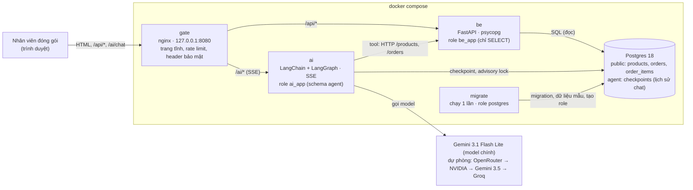
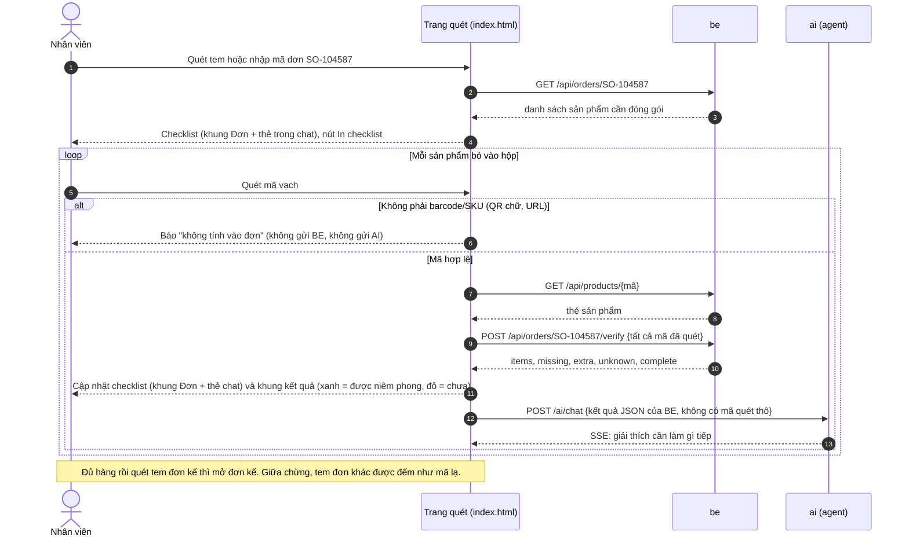
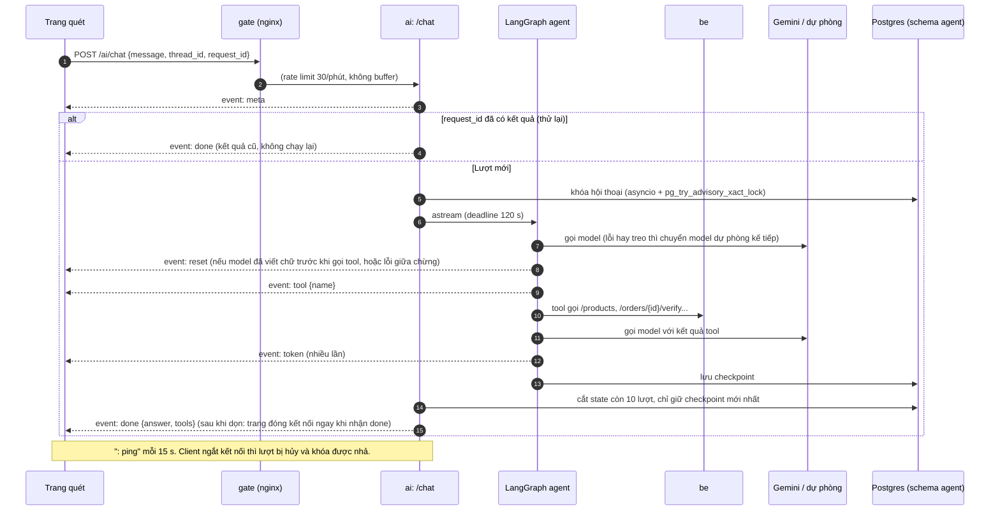
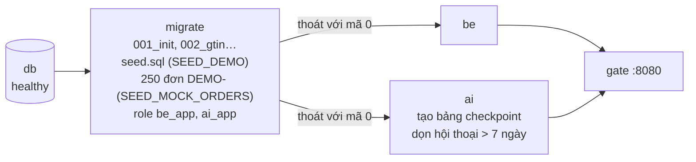
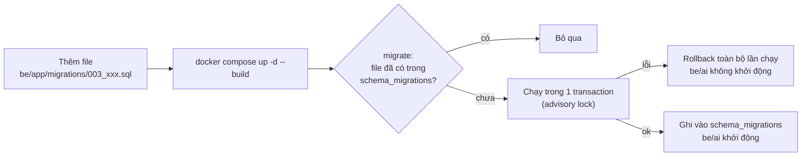

# Barcode Chatbot: kiểm tra đóng gói bằng mã vạch và trợ lý AI

Nhân viên ở bàn đóng gói quét tem mã đơn để mở checklist, rồi quét mã vạch từng sản phẩm bỏ vào hộp. Hệ thống tra sản phẩm trong kho, đối
chiếu với đơn và báo **có được niêm phong hộp hay chưa**. Trợ lý AI giải thích kết quả (thiếu gì, cần lấy gì ra) và trả
lời câu hỏi về sản phẩm và đơn hàng.

> **Nguyên tắc an toàn:** quyết định niêm phong do **BE** đưa ra (`POST /orders/{id}/verify` → `complete`).
> AI chỉ giải thích, không bao giờ tự kết luận. Nhờ vậy, một tem QR bị sửa hay một câu trả lời sai của model không thể
> biến một hộp sai thành "được niêm phong".

## Mục lục

- [Tính năng](#tính-năng)
- [Kiến trúc](#kiến-trúc)
- [Luồng xử lý](#luồng-xử-lý)
- [Cấu trúc thư mục](#cấu-trúc-thư-mục)
- [Cài đặt và chạy](#cài-đặt-và-chạy)
- [Cấu hình](#cấu-hình)
- [API](#api)
- [Bảo mật](#bảo-mật)
- [Kiểm thử](#kiểm-thử)
- [Thay đổi database (migration)](#thay-đổi-database-migration)
- [Vận hành](#vận-hành)
- [Giới hạn hiện tại](#giới-hạn-hiện-tại)

## Tính năng

- **Quét mã:** camera (BarcodeDetector có sẵn trên Android/macOS; Chrome Windows, Firefox, Safari dùng polyfill ZXing WASM),
  tải ảnh, hoặc nhập tay. Mã EAN/UPC phải đúng số kiểm tra GS1 và được đọc trùng 3 lần trong 1,5 s mới được nhận.
- **Camera ổn định** (đo bằng video giả lập 15 điều kiện, xem [Kiểm thử](#kiểm-thử)):
  - Khung hình đọc thường không ra thì thử lại theo 4 cách: thu nhỏ một nửa (đỡ nhiễu khi tối), tăng tương phản (ảnh mờ),
    xoay ±45° (mã cầm chéo). Cách vừa thành công được thử trước ở khung sau. Các cách thử lại chỉ chạy khi vừa đọc được
    mã trong 2 s, còn lại cứ 3 khung trống mới chạy 1 lần (đỡ tốn CPU khi camera để không). Tự lấy nét liên tục nếu camera hỗ trợ.
  - Món để yên chỉ đếm **một lần**. Cùng mã chỉ được đếm lại khi món đã rời khung ít nhất 0,7 s, nên hai món giống
    nhau vẫn quét liên tiếp được. Món vẫn nằm yên mà tạm không đọc được (ảnh thu nhỏ 32×24 của khung không đổi)
    không bị coi là đã lấy ra.
  - Nhiều mã cùng trong khung (2 món, hoặc hộp có cả EAN và QR): mỗi món đếm một lần, món mới được đọc dù món cũ còn trong khung.
  - Camera bị ngắt (rút USB, app khác chiếm) thì báo lỗi; lệnh giải mã treo quá 3 s thì bỏ qua và quét tiếp.
  - Sau mỗi lần quét chỉ dừng 1,2 s, dù có mở đơn hay không (trong lúc dừng camera không nhìn gì, nên dừng lâu sẽ bỏ sót
    món kế tiếp và không thấy món vừa quét đã được lấy ra).
- **Tra sản phẩm:** tên, SKU, danh mục, giá, tồn kho. Mã EAN-13 có số 0 đầu, UPC-A 12 số và GTIN-14 được coi là cùng một mã.
- **Mở đơn:** quét tem mã đơn (Code 128, QR…) hoặc nhập tay. Tem đơn chỉ được đọc khi chưa mở đơn nào hoặc đơn đang
  mở đã đủ hàng, nên giữa chừng mọi mã quét đều được đếm vào đơn (quét nhầm tem đơn khác sẽ hiện là mã không có trong
  kho, không đổi đơn). Đủ hàng rồi quét tem đơn kế là mở luôn đơn đó. Mã không phải đơn (vd SKU) được tra như sản phẩm.
- **Checklist đơn, cập nhật theo từng lần quét:**
  - Khung "Đơn": từng sản phẩm đã quét/cần (✓ khi đủ), khung kết quả xanh hoặc đỏ (còn thiếu, cần lấy ra, mã không có trong kho).
  - Khung chat: thẻ "📦 Checklist đơn" với cùng nội dung, sửa tại chỗ và dời xuống cuối sau mỗi lần quét; mỗi đơn một thẻ,
    thẻ của đơn trước giữ lại tình trạng lúc chuyển đơn. Thẻ ẩn với trình đọc màn hình (khung Đơn đã đọc kết quả).
  - Nút "In checklist": in riêng danh sách đơn (nền trắng chữ đen), mỗi dòng có ô ☐ để đánh dấu tay, dòng đã đủ in ☑.
- **Trợ lý AI (tiếng Việt):** câu trả lời stream theo thời gian thực (SSE). AI dùng 4 tool gọi API của BE:
  `get_product`, `search_products`, `get_order`, `verify_order`. Lịch sử hội thoại lưu trong Postgres. AI không nhận
  tên khách (xem [Bảo mật](#bảo-mật)): hỏi "đơn này của ai" thì AI nhờ xem trên màn hình đơn.
- **Ổn định:** hủy lượt khi client ngắt kết nối, giới hạn thời gian mỗi lượt, mỗi hội thoại chạy từng lượt một
  (khóa cả trong process và trong Postgres), thử lại không chạy lặp.
- **Chuỗi model dự phòng:** Gemini 3.1 Flash Lite → OpenRouter → NVIDIA → Gemini 3.5 → Groq (`agent/.../fallback.py`).
  Model chính chờ tối đa 15 s và không thử lại; lỗi hay treo thì chuyển ngay model kế tiếp. Model lỗi được tạm bỏ qua
  để các câu sau không phải chờ nó: quá thời gian 2 phút, giới hạn theo phút 1 phút, hết quota ngày 1 giờ, sai key hay
  tên model 1 giờ, lỗi chứng chỉ SSL 10 phút. Hãng không có key thì không nằm trong chuỗi.

## Kiến trúc



| Service | Công nghệ | Vai trò |
|---|---|---|
| `gate` | nginx 1.28 | Phục vụ trang quét mã; chuyển `/api/` tới `be` và `/ai/` tới `ai`; rate limit, CSP, chặn Host lạ |
| `be` | Python 3.13, FastAPI, psycopg 3 | Sản phẩm, đơn hàng, đối chiếu đơn. Quyết định niêm phong |
| `ai` | LangChain `create_agent`, LangGraph, AsyncPostgresSaver | Chat SSE, tool gọi BE, lưu lịch sử |
| `migrate` | (image của `be`) | Chạy migration, nạp dữ liệu mẫu, tạo role `be_app` / `ai_app`, rồi thoát |
| `db` | Postgres 18.6 | Dữ liệu kho (schema `public`) và lịch sử chat (schema `agent`) |

## Luồng xử lý

### Quét mã và kiểm tra đơn



### Một lượt chat AI (SSE)



### Khởi động hệ thống



Nếu một migration lỗi, `migrate` thoát với mã khác 0 và `be`, `ai` không khởi động. Database giữ nguyên như trước.

## Cấu trúc thư mục

```
.
├── docker-compose.yml          # db, migrate, be, ai, gate
├── .env.example                # mẫu biến môi trường
└── src/barcode_chatbot/
    ├── fe/                     # trang quét + gateway nginx
    │   ├── index.html          # giao diện: camera, mở đơn, checklist (khung Đơn, chat, bản in), chat SSE
    │   ├── core.js             # logic quét thuần (GS1, chuẩn hóa mã, đồng thuận nhiều khung hình, chống đếm trùng, QR)
    │   ├── core.test.js        # test logic quét (node)
    │   ├── default.conf.template  # cấu hình nginx
    │   └── e2e/                # test Playwright: server giả + kịch bản
    ├── be/                     # backend
    │   ├── app/
    │   │   ├── server.py       # API, migrate, tạo role, self-check
    │   │   ├── migrations/     # NNN_*.sql, chạy theo thứ tự, mỗi file 1 lần
    │   │   ├── seed.sql        # dữ liệu mẫu (SEED_DEMO=true)
    │   │   └── seed_orders.py  # 250 đơn giả DEMO-… (SEED_MOCK_ORDERS=true) + CLI tạo lại
    │   └── tests/              # pytest không cần DB (đơn giả)
    └── agent/                  # trợ lý AI
        ├── src/packing_agent/
        │   ├── api.py          # POST /chat (SSE), khóa, deadline, cache thử lại, dọn state
        │   ├── agent.py        # create_agent + middleware cắt lịch sử và dự phòng
        │   ├── fallback.py     # chuỗi model dự phòng, tạm bỏ qua model bị giới hạn/lỗi cấu hình
        │   ├── tools.py        # 4 tool gọi API của BE
        │   ├── prompts.py      # system prompt tiếng Việt; lọc markdown và "ạ" cuối câu (cả khi stream)
        │   ├── history.py      # chỉ gửi 4 lượt gần nhất cho model
        │   └── llm.py          # Gemini 3.1 (chính); OpenRouter, NVIDIA, Gemini 3.5, Groq (dự phòng); phân loại lỗi
        └── tests/              # pytest (+ test_postgres.py khi có TEST_DATABASE_URL)
```

## Cài đặt và chạy

**Yêu cầu:** Docker (Compose v2), API key Google (Gemini) và OpenRouter.
Để phát triển và chạy test: `uv` (Python 3.13) và Node.js.

```bash
cp .env.example .env     # điền mật khẩu và API key (xem Cấu hình)
docker compose up -d --build
```

Mở http://localhost:8080, quét tem hoặc nhập đơn `SO-104587`, rồi quét hoặc gõ lần lượt `8935000100011`, `8935000200018`,
`8935000300015`. Khung kết quả chuyển xanh khi đủ hàng.

Dữ liệu mẫu (`be/app/seed.sql`): 7 sản phẩm, 3 đơn `SO-104587` (3 sản phẩm), `SO-104588` (chuột ×2, Salonpas ×3)
và `X55277605433` (Salonpas ×1, vở ClassMate ×3, chuyển từ hệ thống `barcode_cv` cũ).
Đơn giả cho demo/thử tải (`be/app/seed_orders.py`, bật bằng `SEED_MOCK_ORDERS=true`, mặc định tắt): 250 đơn
`DEMO-000001`…`DEMO-000250`, mỗi đơn 2–5 sản phẩm còn hàng, số lượng 1–4, tên khách giả. Tiền tố `DEMO-` không bao giờ
trùng mã đơn thật, nên đơn giả không thể thay chỗ đơn thật và `--clean` không xóa nhầm đơn thật. Seed cố định: lần nào
cũng ra cùng đơn; đơn đã có (kể cả đã sửa) không bị ghi đè; kho còn dưới 2 sản phẩm còn hàng thì `migrate` bỏ qua đơn giả.
Tạo lại: `cd src/barcode_chatbot/be && uv run python -m app.seed_orders --clean` (thêm `--count`, `--seed`, `--sql-out file.sql`).

> Mạng có SSL inspection (proxy công ty): đặt chứng chỉ CA (`*.crt`) vào `src/barcode_chatbot/agent/certs/` rồi build lại `ai`.
> Thư mục này bị git bỏ qua.

## Cấu hình

| Biến | Bắt buộc | Dùng bởi | Ý nghĩa |
|---|---|---|---|
| `POSTGRES_PASSWORD` | ✓ | db, migrate | Mật khẩu superuser `postgres` |
| `BE_DB_PASSWORD` | ✓ | migrate, be | Mật khẩu role `be_app`. Chỉ dùng chữ và số, vì nó nằm trong URL |
| `AI_DB_PASSWORD` | ✓ | migrate, ai | Mật khẩu role `ai_app`. Chỉ dùng chữ và số |
| `OPENROUTER_API_KEY` | ✓ | ai | Model dự phòng đầu tiên |
| `GOOGLE_API_KEY` | ✓ | ai | Gemini 3.1: model chính; Gemini 3.5: dự phòng |
| `NVIDIA_API_KEY` | | ai | NVIDIA, model dự phòng thứ 2. Để trống thì NVIDIA bị bỏ khỏi chuỗi dự phòng (không gửi gì tới NVIDIA) |
| `GROQ_API_KEY` | | ai | Groq, model dự phòng cuối cùng. Để trống hoặc `unused` thì bị bỏ khỏi chuỗi |
| `LANGSMITH_API_KEY`, `LANGSMITH_TRACING`, `LANGSMITH_PROJECT` | | ai | Tracing. `true` sẽ gửi cả hội thoại lên LangSmith |
| `SEED_DEMO` | | migrate | `true` (mặc định) nạp dữ liệu mẫu; không ghi đè dòng đã sửa |
| `SEED_MOCK_ORDERS` | | migrate | `true` nạp thêm 250 đơn giả `DEMO-…`; mặc định `false` |
| `GATE_PORT` | | gate | Cổng trên máy, mặc định `8080` |
| `DATABASE_URL` | | chạy BE ngoài Docker | Dùng `127.0.0.1:5433`, không dùng `localhost` |
| `DOCS` | | be, ai | `true` bật `/docs` và `openapi.json` khi phát triển; mặc định tắt |

Container `ai` chỉ nhận các biến được liệt kê trong `docker-compose.yml`; các key khác trong `.env` không vào container.

## API

Mọi đường dẫn bên dưới đi qua gateway `http://localhost:8080`.

### BE (`/api/`)

| Method | Đường dẫn | Mô tả |
|---|---|---|
| GET | `/api/health` | Kiểm tra kết nối DB |
| GET | `/api/products?q=&limit=` | Tìm theo tên, SKU, barcode, danh mục (khớp một phần, có index trigram); mặc định 20, tối đa 100 |
| GET | `/api/products/{barcode hoặc SKU}` | Một sản phẩm. Barcode so theo GTIN (12, 13 hay 14 số đều khớp) |
| GET | `/api/orders/{order_id}` | Đơn hàng và các sản phẩm cần đóng gói |
| POST | `/api/orders/{order_id}/verify` | Body `{"barcodes": [...]}`, mỗi lần quét là 1 phần tử, tối đa 500. Trả `items` (đã quét/cần), `missing`, `extra`, `unknown`, `complete`. Chỉ đọc, không lưu gì |

Mã và mã đơn chỉ gồm chữ, số và `-`, dài 1–64 ký tự; sai định dạng thì trả 422.

### AI (`/ai/chat`)

`POST /ai/chat` với body `{"message": "...", "thread_id": "<uuid>", "request_id": "<uuid>"}`.

- `thread_id`: hội thoại. Trang tạo mã này khi mở, để lượt đầu có lỗi cũng không mất hội thoại.
- `request_id`: mỗi câu hỏi một mã. Gửi lại cùng `(thread_id, request_id)` sẽ nhận kết quả cũ, không chạy lại agent.

Phản hồi là `text/event-stream`:

| Event | Data | Ghi chú |
|---|---|---|
| `meta` | `{thread_id, request_id}` | Luôn là event đầu tiên |
| `tool` | `{name}` | Agent bắt đầu gọi một tool |
| `token` | `{text}` | Một đoạn câu trả lời, chỉ để hiển thị dần. Đã bỏ markdown và "ạ" cuối câu; chữ cuối cùng được giữ lại tới mảnh sau để không lộ `**` hay "ạ" bị cắt đôi |
| `done` | `{thread_id, answer, tools}` | Câu trả lời chính thức; thay toàn bộ text đã stream |
| `reset` | `{}` | Bỏ chữ đã stream: model trước lỗi giữa chừng (model dự phòng trả lời lại) hoặc chữ trước khi gọi tool |
| `error` | `{status, detail}` | 409 hội thoại đang bận · 429 quá tải · 500 lỗi lạ · 502 lỗi model · 503 bận hoặc lỗi DB · 504 quá 120 s, hoặc model cuối chuỗi quá thời gian chờ |

Giới hạn thời gian các lớp: mỗi lần gọi model chính 15 s (OpenRouter 30 s, các model khác 60 s); một lượt 120 s; chờ lượt
trước 20 s; trang bỏ cuộc sau 170 s hoặc khi 45 s không nhận được gì; nginx ngắt sau 180 s không có dữ liệu. Vì có `: ping` mỗi 15 s, kết nối không bị ngắt khi chờ.

## Bảo mật

| Lớp | Biện pháp |
|---|---|
| Mạng | Gateway chỉ mở trên `127.0.0.1`; DB chỉ mở `127.0.0.1:5433`. Chưa có đăng nhập: phải thêm đăng nhập và HTTPS trước khi mở ra LAN (camera trên điện thoại cũng cần HTTPS) |
| Kết luận niêm phong | Do BE quyết định. Mã không phải barcode/SKU không được tính vào đơn và không bao giờ vào prompt; AI chỉ nhận JSON kết quả của BE |
| Database | Mỗi service một role quyền tối thiểu: `be_app` chỉ SELECT 3 bảng; `ai_app` chỉ có schema `agent`; `postgres` chỉ dùng cho `migrate`. PUBLIC bị thu hết quyền trên database (không CONNECT, không TEMP); mật khẩu role gửi dạng SCRAM, không lọt vào log. `check()` kiểm tra lại toàn bộ quyền này. SQL luôn dùng tham số; ký tự `%`/`_` trong ô tìm kiếm được escape |
| Gateway | Rate limit `/ai/` (30/phút, burst 20); chuyển nguyên đường dẫn đã mã hóa (không giải mã `%2F`/`..`); CSP, `X-Frame-Options`, `nosniff`, `Referrer-Policy`; ẩn phiên bản nginx; chặn `/docs` và `openapi.json`; ngắt request có Host lạ |
| Secret | `.env` và `certs/*.crt` bị git bỏ qua; image agent chỉ nhận `*.crt`, không bao giờ nhận khóa riêng; container chỉ nhận biến cần dùng |
| Trang | Mọi nội dung hiển thị đều được escape, kể cả số lượng; câu trả lời AI hiển thị bằng `textContent` (dấu markdown `**`, `#`, `*` bị agent bỏ trước khi gửi); CSV xuất ra được chặn chèn công thức |
| Dữ liệu gửi LLM | Tool `get_order` chỉ đưa cho model 4 trường: mã đơn, trạng thái, ngày tạo, sản phẩm. Tên khách (và cột cá nhân nào BE thêm sau này) không tới được tối đa 5 hãng LLM nhận hội thoại; tên khách chỉ hiện trên màn hình. Kết quả kiểm tra đơn gửi cho AI cũng không có tên khách. Hãng không có key thì không nằm trong chuỗi dự phòng. Lỗi của hãng chỉ ghi 200 ký tự đầu vào log. Telemetry của thư viện NVIDIA tắt |
| Chi phí LLM | Rate limit, tối đa 8 lượt chạy cùng lúc, Gemini `max_output_tokens=1024`, NVIDIA `max_completion_tokens=4096`, Groq `max_tokens=512`. Nên đặt thêm giới hạn chi tiêu trên dashboard của nhà cung cấp |

## Kiểm thử

| Bộ test | Lệnh | Cần |
|---|---|---|
| Agent (80 test, gồm 3 test Postgres) | `cd src/barcode_chatbot/agent && uv run pytest` | Không cần LLM, BE hay DB (test Postgres tự bỏ qua) |
| Agent với Postgres | `TEST_DATABASE_URL=postgresql://postgres:<POSTGRES_PASSWORD>@127.0.0.1:5433/barcode_chatbot uv run pytest` | DB đang chạy; dùng schema tạm rồi xóa |
| BE: đơn giả (6 test, không cần DB) | `cd src/barcode_chatbot/be && uv run pytest` | Chỉ cần `uv` |
| BE + migration (self-check) | `docker compose run --rm migrate python -m app.server check` | Stack đang chạy; quyền chủ DB (có ghi rồi xóa dòng test, tạo rồi xóa DB tạm) |
| Gateway thật (header + giải mã ảnh barcode thật bằng polyfill) | `cd src/barcode_chatbot/fe && npm run test:gate` | Stack đang chạy và mạng tới jsdelivr; bắt được lỗi CSP/cache làm hỏng máy quét |
| Trang: logic quét + E2E Playwright (30 test) | `cd src/barcode_chatbot/fe && npm ci && npx playwright install chromium && npm test` | Chỉ cần Node; server giả cho BE và AI |

Phạm vi self-check của BE: API qua `TestClient`, migration (mỗi file đúng 1 lần), 3 lần `migrate` chạy cùng lúc trên DB
trống, bước khởi tạo lỗi giữa chừng vẫn báo đúng lỗi và nhả khóa `migrate`, mật khẩu role không nằm trong câu SQL, quyền
của từng role.

Phạm vi test agent: chuỗi dự phòng (cả đường bất đồng bộ mà `/chat` dùng, thời gian tạm bỏ qua cho từng loại lỗi, hãng
thiếu key bị bỏ, thứ tự model), mã HTTP cho từng loại lỗi, log lỗi chỉ 200 ký tự và không traceback, lọc chữ stream ở mọi
cách cắt mảnh, `reset` khi model lỗi giữa chừng hoặc viết chữ trước khi gọi tool, `get_order` không lộ tên khách.

Phạm vi test logic quét (`core.test.js`): số kiểm tra GS1, đồng thuận nhiều khung hình, chống đếm trùng (món để yên,
món rời khung rồi quay lại, nhiều mã trong khung theo thứ tự bất kỳ, món nằm yên mà tạm không đọc được).

Phạm vi E2E: kết luận do BE quyết định, QR chứa chữ không tới AI, SSE bị cắt giữa chừng, `error` → "Thử lại" với cùng
`request_id`, stream đứt trước `done`, gộp các yêu cầu chờ, thử lại + gộp không nhận câu trả lời cũ, khóa khi đang tải đơn,
verify lỗi → "KHÔNG niêm phong", response verify cũ về muộn không ghi đè kết luận mới, trạng thái "Đang tra kho…", quét tem đơn (mở đơn, giữa chừng không đổi đơn, đủ hàng thì mở đơn kế, tem để yên trước camera chỉ mở đơn một lần),
mã không phải đơn được tra như sản phẩm, in checklist, checklist trong chat cập nhật theo mỗi lần quét, camera: món để yên
đếm 1 lần, 2 món trong khung mỗi món 1 lần, lệnh giải mã treo không làm dừng quét, camera bị ngắt thì báo lỗi, mã chỉ
đọc được bằng ảnh thu nhỏ vẫn được đếm, số lần đọc lại khi camera để không, tra mã đơn lỗi thì mã vẫn được đếm (hộp đủ
không giữ khung xanh), ô ☐/☑ khi in, thẻ checklist trong chat (ẩn với trình đọc màn hình, không dời khi chỉ cập nhật),
sự kiện `reset`.

Thử trên 250 đơn giả qua stack thật (12/11/2026, script không nằm trong repo):
- BE, cả 250 đơn × 8 trường hợp (đủ hàng, hộp trống, thiếu 1, thừa 1, món không thuộc đơn, mã lạ, mã GTIN-14):
  2.000 request, 0 lỗi; tuần tự trung vị 5 ms, p95 30 ms; 16 luồng song song 350 request/giây, p95 62 ms.
- Trang thật, 20 đơn rải đều: gõ từng món như người đóng gói → khung xanh, thêm 1 món → đỏ "Lấy ra khỏi hộp": 20/20.
- AI, 3 đơn: nêu đủ sản phẩm, không lộ tên khách, giải thích đúng món còn thiếu: 6/6.

Độ ổn định của camera với bộ giải mã thật được đo thủ công bằng video giả lập (`--use-file-for-fake-video-capture`):
mã EAN-13 ở 15 điều kiện (đứng yên, xa 15–25% khung, lệch góc, nghiêng 20/45/60/90°, rung, mờ, tối + nhiễu, mờ + tối,
chói, 2 món, khung trống) và lấy ra rồi đưa lại. Tất cả đọc được trong 0,6–2 s, mỗi món đếm đúng 1 lần, khung trống
không đọc nhầm. Bộ video này không nằm trong repo (khoảng 1 GB).

> Trên Windows dùng `127.0.0.1` thay cho `localhost`: `localhost` thử IPv6 trước và mỗi kết nối chờ khoảng 8 s.

## Thay đổi database (migration)



- Thêm file mới với số tiếp theo, ví dụ `003_add_product_weight.sql`. **Không sửa file đã chạy.**
- Đổi tên hay kiểu cột, chuyển dữ liệu: viết trong file mới. Không có rollback migration tự động, cần đảo ngược thì viết thêm file.
- Bảng mới mà BE cần đọc phải có `GRANT SELECT ... TO be_app;` trong cùng file.
- Dữ liệu mẫu để trong `seed.sql`, không để trong migration.

## Vận hành

| Việc | Lệnh |
|---|---|
| Xem trạng thái | `docker compose ps -a` (be, ai, gate có healthcheck; `gate` chỉ khởi động khi be và ai healthy) |
| Xem log | `docker compose logs -f ai` (hoặc `be`, `gate`, `migrate`) |
| Deploy bản mới | `docker compose up -d --build` |
| Gắn tag image trước khi deploy | `docker tag barcode_chatbot-ai:latest barcode_chatbot-ai:prev` (tương tự cho `be`, `gate`) |
| Rollback nhanh | Tag `:prev` thành `:latest`, rồi `docker compose up -d --no-build` |
| Rollback theo git | `git revert <commit>`, rồi `docker compose up -d --build`. Migration chỉ thêm, nên DB không cần quay lại |
| Dừng (giữ dữ liệu) | `docker compose down`. Thêm `-v` sẽ **xóa** volume DB |

Lỗi thường gặp:
- **Cổng 8080 đang bận khi tạo lại `gate`:** container cũ chưa nhả cổng kịp. Chạy lại `docker compose up -d gate`.
- **`migrate` thoát với mã khác 0:** xem `docker compose logs migrate`. Database chưa bị thay đổi, sửa file migration lỗi rồi deploy lại.
- **`migrate` lỗi `could not create unique index "products_gtin_key"`** (migration `002_gtin`): có 2 sản phẩm cùng quy về
  một GTIN (vd `012345678905` và `0012345678905`). Tìm bằng
  `SELECT lpad(barcode,14,'0') g, array_agg(sku) FROM products WHERE barcode ~ '^[0-9]{8,14}$' GROUP BY g HAVING count(*) > 1;`,
  sửa dữ liệu rồi deploy lại.
- **Quét ảnh/camera báo "Could not read this image" trên Chrome Windows, Firefox, Safari:** các trình duyệt
  này không có `BarcodeDetector` sẵn nên tải polyfill ZXing từ `cdn.jsdelivr.net`, và file WASM của nó từ
  `fastly.jsdelivr.net`. Cả hai phải được phép trong CSP (`default.conf.template`) và qua được proxy/firewall công ty.
- **Không mở được trang từ điện thoại/máy khác:** gateway chỉ nghe `127.0.0.1` và chỉ nhận Host `localhost`/`127.0.0.1`
  (`server_name` trong `default.conf.template`). Cần thêm đăng nhập và HTTPS rồi mới mở ra mạng.
- **Camera không đọc được mã:** đưa mã vào khung nét đứt, đủ sáng, cách khoảng 15–30 cm; mã quá nhỏ trong khung thì
  trang báo "move a little closer". Màn hình đứng hình thì bấm tắt rồi bật lại camera.
- **Một món bị đếm 2 lần:** món bị lấy ra khỏi khung hơn 0,7 s rồi đưa lại, hoặc camera tự chỉnh sáng mạnh làm cả khung
  đổi màu. Lấy món thừa ra theo khung kết quả (BE báo "Lấy ra khỏi hộp"), hoặc bấm "Quét lại từ đầu".
- **Chat chậm (10–30 s), log có `LLM gemini-… quá thời gian chờ` hoặc `Trả lời bằng model dự phòng`:** Gemini đang
  chậm hoặc lỗi (504/503 phía Google), câu trả lời do model dự phòng đưa ra. Gemini được thử lại sau 2 phút.
- **AI báo 429 liên tục:** rate limit của gateway hoặc hết quota của nhà cung cấp LLM. Xem `docker compose logs ai | grep "rate limit"`.

## Giới hạn hiện tại

- Chưa có đăng nhập; gateway chỉ dùng được trên chính máy chạy Docker.
- Cache kết quả theo `request_id` và khóa asyncio nằm trong RAM, nên agent chạy 1 worker. Khóa advisory trong Postgres
  bảo vệ khi có nhiều worker, nhưng cache thử lại thì không dùng chung.
- Rate limit tính theo IP; qua cổng Docker mọi client có thể chung một IP, nên thực tế là giới hạn chung.
- Đối chiếu đơn chỉ đọc: chưa lưu lịch sử đóng gói, chưa cập nhật trạng thái đơn, chưa trừ tồn kho.
- Mã UPC-E (6–8 số) chưa được mở rộng thành UPC-A khi so khớp.
- Chưa có migration kiểm tra checksum: sửa một file đã chạy sẽ không bị phát hiện.
- Camera mới được đo bằng video giả lập, chưa thử với camera và tem thật; tự lấy nét chưa kiểm được (camera giả không có).
- Phần so khung hình 32×24 (món nằm yên mà tạm không đọc được) chưa có test tự động; camera giả của Playwright chiếu
  hình động nên luôn bị coi là đã đổi. Camera tự chỉnh sáng mạnh cũng bị coi là đổi khung, khi đó quay về đếm theo thời gian.
- Các cách đọc lại tốn CPU: chạy mỗi khung trong 2 s sau lần đọc được mã, sau đó 1/3 số khung. Chưa đo trên điện thoại.
- Thời gian chờ 15 s của Gemini mới đo trong một buổi Gemini đang chậm. Lỗi 503 của Gemini chưa làm nó bị tạm bỏ qua.
- Đơn giả `DEMO-…` có ngày tạo tính lùi từ lúc nạp, nên file `--sql-out` mỗi lần chạy khác nhau ở cột ngày.
- Mã đơn toàn số mà trùng dạng mã vạch sản phẩm hợp lệ sẽ bị đọc là sản phẩm; đơn kiểu đó phải nhập tay.
- Chưa in được tem mã vạch cho đơn; tem đơn phải in từ hệ thống khác.
